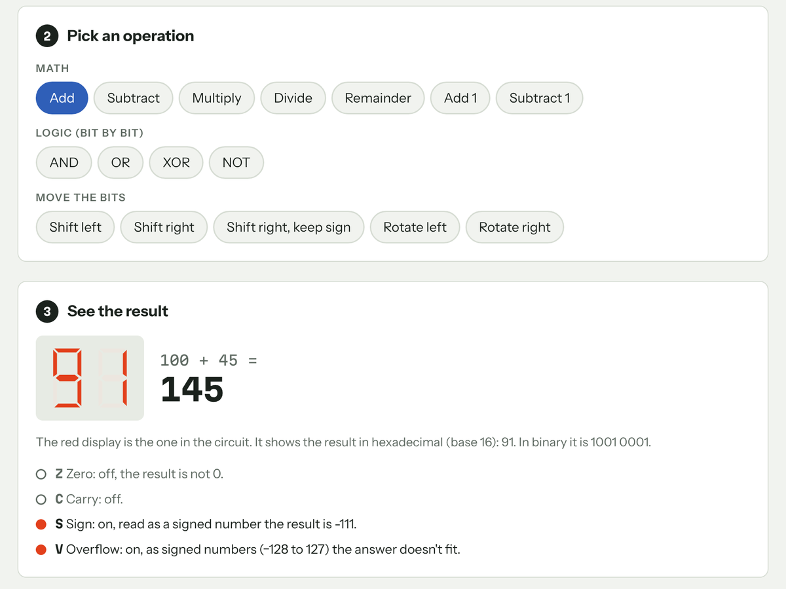
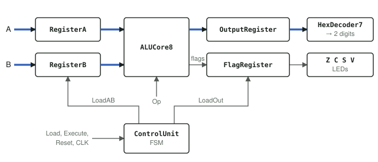
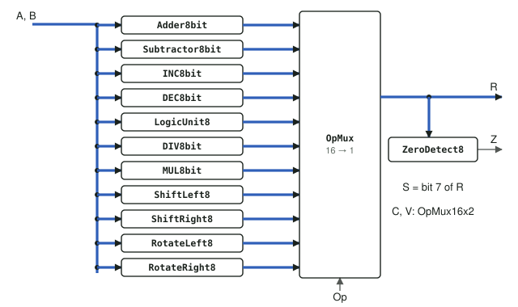
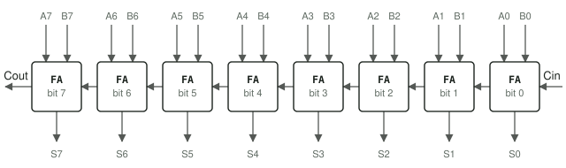
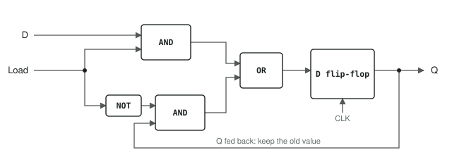
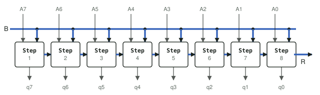
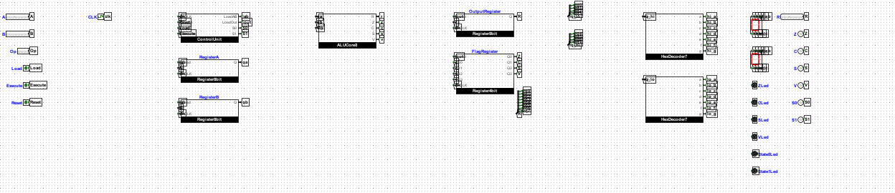
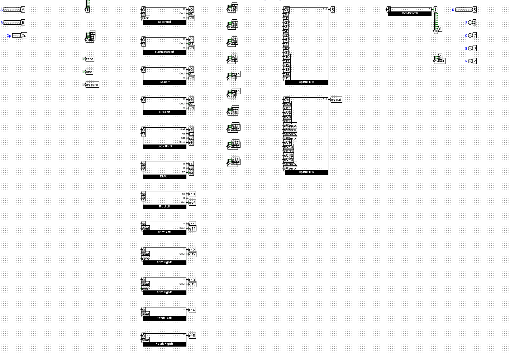
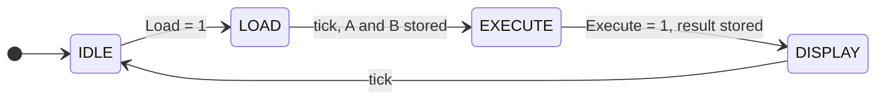

<div align="center">

# 8-bit ALU from Logic Gates

An 8-bit Arithmetic Logic Unit built from nothing but logic gates and D flip-flops
in **Logisim Evolution**. 16 operations, 4 status flags, a clocked control unit and
a hex and a decimal display. No prebuilt adders, multiplexers or registers.


**[Try it in your browser](https://rakcery.github.io/logisim-8bit-alu/)** · [Download ALU.circ](https://github.com/Rakcery/logisim-8bit-alu/releases/latest/download/ALU.circ) · [How it is built](#how-it-is-built) · [Opcodes](#opcodes) · [Türkçe](README.tr.md)



</div>

## Quick start

> **No install:** open the [browser playground](https://rakcery.github.io/logisim-8bit-alu/), type two numbers and pick an operation.
>
> **In Logisim:**
> 1. Install [Logisim Evolution 4.0.0](https://github.com/logisim-evolution/logisim-evolution/releases/tag/v4.0.0) (pick the installer for your system).
> 2. Download [`ALU.circ`](https://github.com/Rakcery/logisim-8bit-alu/releases/latest/download/ALU.circ) and open it. The `main` circuit opens.
> 3. Follow the six steps in [Run it in Logisim](#run-it-in-logisim).

## What it does

| | |
|---|---|
| **Arithmetic** | ADD, SUB, INC, DEC, MUL, DIV, MOD |
| **Logic** | AND, OR, XOR, NOT |
| **Shift / rotate** | SHL, SHR, SAR, ROL, ROR by 0 to 7 places (barrel shifter) |
| **Flags** | Z zero, C carry, S sign, V overflow or error |
| **Control** | 4-state Moore FSM: IDLE → LOAD → EXECUTE → DISPLAY |
| **CPU** | a mini processor that runs programs from ROM (see [Mini CPU](#mini-cpu)) |
| **Output** | 7-segment displays: two hex digits and three decimal digits (gate-level binary to decimal converter), flag and state LEDs |

## Try it in your browser

Not everyone has Logisim installed, so [`docs/index.html`](docs/index.html) is a
one-page guide ([live here](https://rakcery.github.io/logisim-8bit-alu/)) to the project, in English and Turkish. Enter two numbers, pick an operation, and see the
result, the hex display and what each flag light means. Below that, every block
has a small schematic: click a box to open it, all the way from `main` down to a
single register bit. The page's math is checked against the same test vectors as
the circuit.

## How it is built

Everything is a subcircuit made of smaller subcircuits, starting from single gates.

**The whole system** (`main`). Registers hold A, B, the result and the flags. They
only change on a clock tick, when the control unit says so.



**The ALU** (`ALUCore8`). Every operation block computes at the same time; the
4-bit opcode tells a 16-way multiplexer which answer becomes R.



**Addition** (`Adder8bit`). Eight full adders in a chain, carry rippling from
bit 0 to bit 7, just like adding on paper. Subtraction, increment and decrement
reuse the same adder.



**Memory** (`Register8bit`). Each bit is a D flip-flop with a small selector in
front: when Load is 1 it stores the new value on the next tick, otherwise it
keeps its own.



**Division** (`DIV8bit`). Long division in binary: 8 steps, each bringing down one
bit of A, checking whether B fits, subtracting if so and writing one quotient bit.



**In Logisim.** This is what `main` and `ALUCore8` look like in the real file. Blocks are
joined with named tunnels (the small labels) instead of long wires, so a signal like
`qa` or `r5` goes wherever the same label appears. That keeps a circuit this big readable.





Every block, its ports and what it is built from are listed in
[docs/blocks.md](docs/blocks.md).

## Opcodes

| Op | Operation | R | C | V |
|---|---|---|---|---|
| `0000` | ADD | A + B | carry out | signed overflow |
| `0001` | SUB | A − B | 1 = no borrow (A ≥ B) | signed overflow |
| `0010` | INC | A + 1 | carry out | signed overflow |
| `0011` | DEC | A − 1 | carry out | signed overflow |
| `0100` | DIV | A ÷ B | 0 | 1 if B = 0 |
| `0101` | AND | A & B | 0 | 0 |
| `0110` | OR | A \| B | 0 | 0 |
| `0111` | XOR | A ^ B | 0 | 0 |
| `1000` | NOT | ~A | 0 | 0 |
| `1001` | MOD | A mod B | 0 | 1 if B = 0 |
| `1010` | MUL | (A × B) low 8 bits | high byte ≠ 0 | high byte ≠ 0 |
| `1011` | SHL | A << B[2:0] | last bit shifted out | 0 |
| `1100` | SHR | A >> B[2:0], zeros in | last bit shifted out | 0 |
| `1101` | SAR | A >> B[2:0], sign kept | last bit shifted out | 0 |
| `1110` | ROL | A rotated left by B[2:0] | 0 | 0 |
| `1111` | ROR | A rotated right by B[2:0] | 0 | 0 |

Z = 1 when R = 0, and S = bit 7 of R, for every opcode. Dividing by zero gives
Q = 0 and remainder = A, with V = 1 as an error flag.

## Run it in Logisim

1. Open `ALU.circ` in [Logisim Evolution 4.0.0](https://github.com/logisim-evolution/logisim-evolution/releases/tag/v4.0.0). The `main` circuit opens.
2. Set **A**, **B** and **Op** with the input pins (Poke tool, click the bits).
3. Set **Load** to 1 and tick the clock (Ctrl+T): IDLE → LOAD.
4. Set **Load** back to 0 and tick: A and B are stored, LOAD → EXECUTE.
5. Set **Execute** to 1 and tick: the result and flags are stored, EXECUTE → DISPLAY.
6. Read the result on the hex or decimal display and the Z / C / S / V LEDs. One more tick returns to IDLE.

**Reset** = 1 sends the control unit back to IDLE on the next tick.



## Mini CPU

The same file has a second top-level circuit, **`cpu`**: a small processor built
around the ALU that runs a program from memory by itself, one instruction per
clock tick. It comes loaded with a Fibonacci program that counts
0, 1, 1, 2, 3, 5 … 233 on the decimal display and then stops.

1. Open `ALU.circ` and double-click **`cpu`** in the circuit list.
2. Set **Reset** to 1, tick once (Ctrl+T), set it back to 0.
3. Tick with Ctrl+T, or let it run with **Simulate → Ticks Enabled** (Ctrl+K).
   The **Halt** LED lights up when the program ends.

| Part | What it does |
|---|---|
| `Program` (ROM, 256 × 16 bit) | holds the program (Logisim's built-in ROM, the one part not made of gates) |
| `PC8` | program counter: next address, or a jump target |
| `Decoder16` | turns an instruction into control signals (gates only) |
| `RegFile4x8` | four 8-bit registers R0–R3, one write and two read ports |
| `ALUCore8` | the ALU above, does every calculation |
| `Flags`, `Display` | remember Z and C for jumps, and the number on the display |

**Instructions** (16 bits: `op[15:12] rd[11:10] rs[9:8] imm[7:0]`):

| op | Instruction | Does |
|---|---|---|
| `0000` | `ADD rd, rs` (any of the 16 ALU operations) | rd = rd op rs, updates Z and C |
| `0001` | `LDI rd, n` | rd = n |
| `0010` | `MOV rd, rs` | rd = rs |
| `0011` | `JMP label` | jump |
| `0100` | `JZ label` | jump if Z = 1 |
| `0101` | `JNZ label` | jump if Z = 0 |
| `0110` | `JC label` | jump if C = 1 |
| `0111` | `OUT rs` | show rs on the display |
| `1000` | `HALT` | stop |

**Other programs:** [`programs/`](programs/) has `countdown` (10 to 0) and
`multiply` (7 × 6 with a loop). In Logisim, right-click the `Program` ROM →
**Load Image…** and pick a `.hex` file. To write your own, save it as `.asm` and run
`python3 tools/asm.py programs/yours.asm`.

## From the 4-bit course project to v2

This started as the final project of the *Digital Logic Design* course at
İstanbul Sağlık ve Teknoloji Üniversitesi (Spring 2025–2026): a **4-bit** ALU
with 9 operations on a 3-bit opcode. That version is kept unchanged in [`v1/`](v1/).

After the course I kept developing it on my own:

| | v1 | v2 |
|---|---|---|
| Width | 4 bits | 8 bits |
| Operations | 9 | 16 (adds MOD, MUL, shifts, rotates) |
| Flags | Z, C, S (C always showed the adder) | Z, C, S, V, correct for every operation |
| Control unit | own clock, did not drive the registers | drives every register load on one shared clock |
| Display | 1 digit, wrong segments for 6, 7, d, E | 2 hex digits plus 3 decimal digits, leading zeros dark |
| Ports | scrambled pin orders | fixed order, 8-bit buses |
| Testing | by hand | 37,000+ automatic test cases in Logisim |

The full list of what was wrong with v1 is in [docs/v1-review.md](docs/v1-review.md).

## Tests

Every block has test vectors in [`tests/vectors/`](tests/vectors/), computed by
plain Python reference models in [`tests/gen_vectors.py`](tests/gen_vectors.py):
edge cases such as 0, 255, 127/128, B = 0 and 0xFF + 1, plus random values. They
run inside Logisim itself:

```sh
JAR=$(bash tools/get_logisim.sh)         # downloads Logisim Evolution 4.0.0
python3 tests/run_tests.py "$JAR"
```

Clocked blocks (registers, ControlUnit, PC8, RegFile4x8, main, cpu) run through
`tools/probe/SeqTest.java`, because Logisim's built-in runner resets the state on
every row. GitHub Actions runs the whole suite on every push.

The repetitive blocks are built by a Python script in [`tools/`](tools/), so a
change to one block can be rebuilt and retested in seconds.

## Repository layout

| Path | Contents |
|---|---|
| `ALU.circ` | the 8-bit ALU (open this) |
| `v1/` | original 4-bit course project |
| `docs/` | browser playground, block list, v1 review |
| `images/` | pictures used in this README |
| `programs/` | example programs for the mini CPU (`.asm` source, `.hex` ROM image) |
| `tools/` | block builder, assembler and Logisim helpers |
| `tests/` | test vectors and runner |

## Author

İdris Salih Yıldırım · [MIT License](LICENSE)
