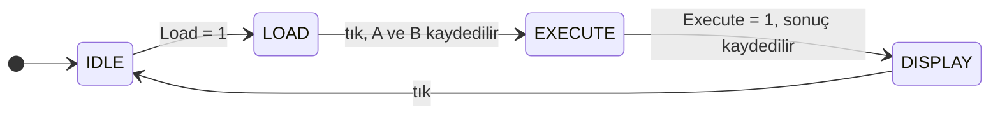

<div align="center">

# Mantık Kapılarından 8-bit ALU

**Logisim Evolution**'da sadece mantık kapıları ve D flip-flop'larla yapılmış 8 bitlik
bir Aritmetik Mantık Birimi (ALU). 16 işlem, 4 durum bayrağı, saatle çalışan bir
kontrol birimi, onaltılık ve onluk ekran. Hazır toplayıcı, multiplexer ya da
register kullanılmadı.


**[Tarayıcıda dene](https://rakcery.github.io/logisim-8bit-alu/?lang=tr)** · [ALU.circ indir](https://github.com/Rakcery/logisim-8bit-alu/releases/latest/download/ALU.circ) · [Nasıl yapıldı](#nasıl-yapıldı) · [Opcode'lar](#opcodelar) · [English](README.md)


</div>

## Hemen dene

> **Kurulum yok:** [tarayıcıdaki oyun alanını](https://rakcery.github.io/logisim-8bit-alu/?lang=tr) aç, iki sayı yaz ve bir işlem seç.
>
> **Logisim'de:**
> 1. [Logisim Evolution 4.0.0](https://github.com/logisim-evolution/logisim-evolution/releases/tag/v4.0.0)'ı kur (sistemine uygun kurulum dosyasını seç).
> 2. [`ALU.circ`](https://github.com/Rakcery/logisim-8bit-alu/releases/latest/download/ALU.circ) dosyasını indir ve aç. `main` devresi açılır.
> 3. [Logisim'de çalıştır](#logisimde-çalıştır) bölümündeki altı adımı izle.

## Ne yapıyor

| | |
|---|---|
| **Aritmetik** | ADD, SUB, INC, DEC, MUL, DIV, MOD |
| **Mantık** | AND, OR, XOR, NOT |
| **Kaydırma / döndürme** | SHL, SHR, SAR, ROL, ROR, 0 ile 7 basamak arası (barrel shifter) |
| **Bayraklar** | Z sıfır, C elde, S işaret, V taşma ya da hata |
| **Kontrol** | 4 durumlu Moore FSM: IDLE → LOAD → EXECUTE → DISPLAY |
| **Çıkış** | 7 segment ekranlar: iki onaltılık hane ve üç onluk hane (kapılardan yapılmış ikilikten onluğa çevirici), bayrak ve durum LED'leri |

## Tarayıcıda dene

Herkesin bilgisayarında Logisim yok, bu yüzden [`docs/index.html`](docs/index.html)
projeyi anlatan tek sayfalık bir rehber ([canlı hali](https://rakcery.github.io/logisim-8bit-alu/?lang=tr)),
Türkçe ve İngilizce. İki sayı gir, bir işlem seç; sonucu, onaltılık ekranı ve her
bayrak ışığının ne anlama geldiğini gör. Altında her bloğun küçük bir şeması var:
bir kutuya tıklayıp içini açabilirsin, `main`'den tek bir register bitine kadar.
Sayfanın hesapları, devreyle aynı test vektörleriyle kontrol ediliyor.

## Nasıl yapıldı

Her şey, daha küçük alt devrelerden oluşan bir alt devre; en altta tek tek kapılar var.

**Sistemin tamamı** (`main`). Register'lar A'yı, B'yi, sonucu ve bayrakları tutar.
Sadece saat tıkladığında ve kontrol birimi söylediğinde değişirler.


**ALU** (`ALUCore8`). Bütün işlem blokları aynı anda hesaplar; 4 bitlik opcode,
16 girişli bir multiplexer'a hangi cevabın R olacağını söyler.


**Toplama** (`Adder8bit`). Zincir halinde sekiz tam toplayıcı; elde, kâğıt üstünde
toplama yapar gibi bit 0'dan bit 7'ye doğru ilerler. Çıkarma, 1 ekleme ve 1 çıkarma
aynı toplayıcıyı kullanır.


**Hafıza** (`Register8bit`). Her bit, önünde küçük bir seçici olan bir D flip-flop'tur:
Load 1 iken bir sonraki tıkta yeni değeri kaydeder, değilse kendi değerini korur.


**Bölme** (`DIV8bit`). İkilik tabanda uzun bölme: 8 adım; her adım A'nın bir bitini
aşağı indirir, B'nin sığıp sığmadığına bakar, sığıyorsa çıkarır ve bölümün bir bitini yazar.


**Logisim'de.** `main` ve `ALUCore8` gerçek dosyada böyle görünüyor. Bloklar uzun teller
yerine isimli tünellerle (küçük etiketler) bağlı; `qa` ya da `r5` gibi bir sinyal, aynı
etiketin olduğu her yere gider. Bu kadar büyük bir devre bu sayede okunabilir kalıyor.


Her blok, portları ve neyden yapıldığı [docs/blocks.md](docs/blocks.md) dosyasında listeli.

## Opcode'lar

| Op | İşlem | R | C | V |
|---|---|---|---|---|
| `0000` | ADD | A + B | elde çıkışı | işaretli taşma |
| `0001` | SUB | A − B | 1 = borç yok (A ≥ B) | işaretli taşma |
| `0010` | INC | A + 1 | elde çıkışı | işaretli taşma |
| `0011` | DEC | A − 1 | elde çıkışı | işaretli taşma |
| `0100` | DIV | A ÷ B | 0 | B = 0 ise 1 |
| `0101` | AND | A & B | 0 | 0 |
| `0110` | OR | A \| B | 0 | 0 |
| `0111` | XOR | A ^ B | 0 | 0 |
| `1000` | NOT | ~A | 0 | 0 |
| `1001` | MOD | A mod B | 0 | B = 0 ise 1 |
| `1010` | MUL | (A × B) alttaki 8 bit | üst bayt ≠ 0 | üst bayt ≠ 0 |
| `1011` | SHL | A << B[2:0] | dışarı itilen son bit | 0 |
| `1100` | SHR | A >> B[2:0], soldan 0 girer | dışarı itilen son bit | 0 |
| `1101` | SAR | A >> B[2:0], işaret korunur | dışarı itilen son bit | 0 |
| `1110` | ROL | A, B[2:0] kadar sola döndürülür | 0 | 0 |
| `1111` | ROR | A, B[2:0] kadar sağa döndürülür | 0 | 0 |

Her opcode için R = 0 iken Z = 1, S de R'nin 7. bitidir. Sıfıra bölmede bölüm 0,
kalan A olur ve hata bayrağı olarak V = 1 yanar.

## Logisim'de çalıştır

1. `ALU.circ`'i [Logisim Evolution 4.0.0](https://github.com/logisim-evolution/logisim-evolution/releases/tag/v4.0.0)'da aç. `main` devresi açılır.
2. **A**, **B** ve **Op** değerlerini giriş pinleriyle ayarla (Poke aracıyla bitlere tıkla).
3. **Load**'u 1 yap ve saati ilerlet (Ctrl+T): IDLE → LOAD.
4. **Load**'u tekrar 0 yap ve saati ilerlet: A ve B kaydedilir, LOAD → EXECUTE.
5. **Execute**'u 1 yap ve saati ilerlet: sonuç ve bayraklar kaydedilir, EXECUTE → DISPLAY.
6. Sonucu onaltılık ya da onluk ekrandan, bayrakları Z / C / S / V LED'lerinden oku. Bir tık daha IDLE'a döndürür.

**Reset** = 1, bir sonraki tıkta kontrol birimini IDLE'a döndürür.



## 4 bitlik ders projesinden v2'ye

Bu proje, İstanbul Sağlık ve Teknoloji Üniversitesi'ndeki *Digital Logic Design*
dersinin (2025–2026 Bahar) final projesi olarak başladı: 3 bitlik opcode ile
9 işlem yapan **4 bitlik** bir ALU. O sürüm [`v1/`](v1/) klasöründe olduğu gibi duruyor.

Dersten sonra kendi başıma geliştirmeye devam ettim:

| | v1 | v2 |
|---|---|---|
| Genişlik | 4 bit | 8 bit |
| İşlemler | 9 | 16 (MOD, MUL, kaydırma ve döndürme eklendi) |
| Bayraklar | Z, C, S (C her zaman toplayıcıyı gösteriyordu) | Z, C, S, V, her işlemde doğru |
| Kontrol birimi | kendi saatiyle çalışıyordu, register'ları sürmüyordu | ortak saatle bütün register yüklemelerini sürüyor |
| Ekran | 1 hane, 6, 7, d, E için yanlış segmentler | 2 onaltılık + 3 onluk hane, baştaki sıfırlar sönük |
| Portlar | karışık pin sıraları | sabit sıra, 8 bitlik bus'lar |
| Test | elle | Logisim'de 37.000+ otomatik test |

v1'deki hataların tam listesi [docs/v1-review.md](docs/v1-review.md) dosyasında (İngilizce).

## Testler

Her bloğun [`tests/vectors/`](tests/vectors/) klasöründe test vektörleri var. Bunları
[`tests/gen_vectors.py`](tests/gen_vectors.py) içindeki sade Python referans modelleri
üretiyor: 0, 255, 127/128, B = 0 ve 0xFF + 1 gibi uç durumlar ve rastgele değerler.
Testler Logisim'in kendi içinde çalışır:

```sh
JAR=$(bash tools/get_logisim.sh)         # Logisim Evolution 4.0.0'ı indirir
python3 tests/run_tests.py "$JAR"
```

Saatle çalışan bloklar (register'lar, ControlUnit, main) `tools/probe/SeqTest.java`
ile test edilir, çünkü Logisim'in kendi test aracı her satırda durumu sıfırlıyor.
GitHub Actions her push'ta bütün testleri çalıştırır.

Tekrarlayan bloklar [`tools/`](tools/) klasöründeki bir Python script'iyle üretiliyor;
böylece bir blokta yapılan değişiklik saniyeler içinde yeniden üretilip test edilebiliyor.

## Repo düzeni

| Yol | İçerik |
|---|---|
| `ALU.circ` | 8 bitlik ALU (bunu aç) |
| `v1/` | orijinal 4 bitlik ders projesi |
| `docs/` | tarayıcıdaki oyun alanı, blok listesi, v1 incelemesi |
| `images/` | README'deki görseller |
| `tools/` | blok üretici ve Logisim yardımcıları |
| `tests/` | test vektörleri ve çalıştırıcı |

## Yazar

İdris Salih Yıldırım · [MIT Lisansı](LICENSE)
